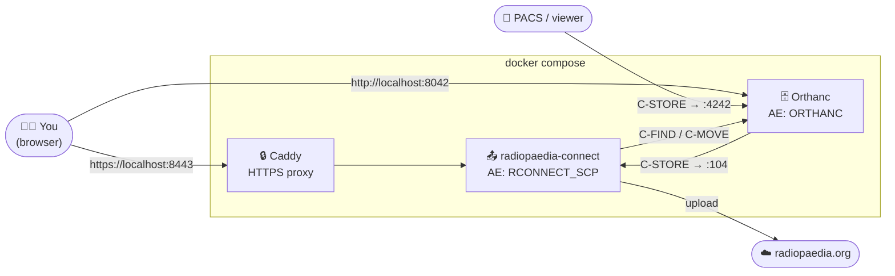

# 🩻 rp-connect

A self-contained Docker stack for submitting cases to [Radiopaedia](https://radiopaedia.org) with **Radiopaedia Connect**, using a local **Orthanc** PACS as the DICOM source.



---

## 🌐 Where to find everything

| What | Address | Notes |
|---|---|---|
| **Radiopaedia Connect** (web UI) | **<https://localhost:8443>** | Served by Caddy with its own local certificate. Accept the browser warning the first time. |
| **Orthanc Explorer 2** (web UI) | **<http://localhost:8042/ui/app/>** | Browse, upload and delete studies. No login. |
| Orthanc classic explorer | <http://localhost:8042/app/explorer.html> | The older UI. |
| Orthanc REST API | <http://localhost:8042/> | e.g. `/statistics`, `/modalities` |
| **Orthanc DICOM** | `localhost:4242`, AE **`ORTHANC`** | Send studies here from your PACS or viewer. |
| Radiopaedia Connect DICOM | `localhost:4104`, AE **`RCONNECT_SCP`** | Usually only Orthanc talks to it, over the internal Docker network on port `104`. |

> 💡 Inside the Docker network, containers reach each other by service name: `orthanc:4242` and `radiopaedia-connect:104`. Use `localhost` only from the host machine.

---

## 🚀 Quick start

```bash
# 1. Create the host folders and a fixed host ID for Orthanc (first time only)
mkdir -p data/radiopaedia-connect data/orthanc data/orthanc-export orthanc.d
[ -f data/orthanc-hostid ] || printf '%x\n' $(shuf -i 268435456-4294967295 -n 1) > data/orthanc-hostid

# 2. Start the stack
docker compose up -d

# 3. Check that everything is up
docker compose ps
```

> ⚠️ Create `data/orthanc-hostid` **before** the first `docker compose up`. If it's missing, Docker creates a *folder* with that name and Orthanc won't start.

Then open **<https://localhost:8443>** and work through the setup below.

---

## ⚙️ Setting up Radiopaedia Connect

All Radiopaedia Connect settings are entered in its web UI and saved in its database, in `data/radiopaedia-connect/`. There's no config file to edit.

### 1️⃣ Initial setup: admin password

On first launch you'll see **Initial Setup**. Choose an **Admin Password** (at least 6 characters). This password protects the **Settings** page.

### 2️⃣ Settings → Radiopaedia

| Field | Value |
|---|---|
| **Client ID** | Your Radiopaedia OAuth client ID |
| **Client Secret** | Your Radiopaedia OAuth client secret |

These are required for signing in and submitting cases. Get them from Radiopaedia.

> 🔐 Never commit these to git. They're stored only in the database under `data/`, which is git-ignored.

### 3️⃣ Settings → DICOM SCP

This is the DICOM receiver Radiopaedia Connect uses to accept images that Orthanc sends back.

| Field | Value | Why |
|---|---|---|
| **AE Title** | **`RCONNECT_SCP`** | Must match the AE title in Orthanc's `RCONNECT_SCP` modality entry in `docker-compose.yml`. Case-sensitive. |
| **Port** | `104` (fixed) | Exposed on the host as `4104`. |

### 4️⃣ Settings → Remote Nodes

Click **+ Add Node** and enter:

| Field | Value |
|---|---|
| **Display Name** | `orthanc` |
| **AE Title** | **`ORTHANC`** |
| **Host / IP** | **`orthanc`** (the Docker service name, *not* `localhost`) |
| **Port** | **`4242`** |
| **Calling AE Title** | **`RCONNECT_SCP`** |

Save it, then press the **DICOM C-ECHO (ping)** button on the node. A success means Radiopaedia Connect can reach Orthanc. ✅

### 5️⃣ Optional settings

| Section | What it's for |
|---|---|
| **Notifications** | SMTP settings and recipients for emails when jobs or the pipeline fail. SSL is turned on automatically for ports 587 and 465. |
| **Anonymisation** | Controls which DICOM tags are kept when anonymising. |
| **Logs** | App, pipeline and DICOM events, kept for 30 days. Your first stop when something fails. |
| **Change Password** | Change the admin password. |

### 🔁 How the AE titles fit together

```
radiopaedia-connect ──(calling AE: RCONNECT_SCP)──▶ ORTHANC @ orthanc:4242
        ▲                                              │
        │       C-MOVE destination: RCONNECT_SCP       │
        └──────────── radiopaedia-connect:104 ◀────────┘
```

When Radiopaedia Connect asks Orthanc for a series, Orthanc looks up **`RCONNECT_SCP`** in its modality list (the `RCONNECT_SCP` entry in `docker-compose.yml`) and sends the images to `radiopaedia-connect:104`. If you change an AE title in one place, change it in the other too.

---

## 🗄️ Orthanc configuration

Orthanc uses the official [`orthancteam/orthanc`](https://hub.docker.com/r/orthancteam/orthanc) image and is configured in two places.

### Shared settings: `docker-compose.yml`

These are set with `ORTHANC__*` environment variables. Each name maps to an Orthanc config key, e.g. `ORTHANC__DICOM_ALWAYS_ALLOW_ECHO` → `DicomAlwaysAllowEcho`.

```yaml
ORTHANC__DICOM_MODALITIES: |
  { "RCONNECT_SCP": ["RCONNECT_SCP", "radiopaedia-connect", 104] }
```

### Machine-local settings: `orthanc.d/*.json` (git-ignored)

Any `*.json` file in `orthanc.d/` is merged with the settings above at startup. This is the place for things that only apply to your machine, such as your own viewer:

```json
{
  "DicomModalities": {
    "timiv": ["timiv", "172.21.0.1", 5035]
  }
}
```

Apply changes with:

```bash
docker compose up -d --force-recreate orthanc
```

> 💡 To reach a service on the host from inside Docker, use the Docker bridge gateway IP (often `172.17.0.1` or `172.21.0.1`). Find yours with `docker network inspect rp-connect_default`.

### 📤 Exporting files from Orthanc

`RestApiWriteToFileSystemEnabled` is on, so you can write an instance to disk:

```bash
curl -X POST http://localhost:8042/instances/<id>/export -d '/export/my-file.dcm'
```

Files appear in **`data/orthanc-export/`** on the host. Paths outside `/export` will fail, because the container is read-only.

---

## 💾 Where your data lives

All persistent data is in host folders. The containers themselves are **read-only** and can be deleted and recreated without losing anything.

```
rp-connect/
├── docker-compose.yml          # the whole stack, including the Caddyfile
├── orthanc.d/                  # 🔒 machine-local Orthanc config (git-ignored)
│   └── local.json
└── data/                       # 🔒 all persistent data (git-ignored)
    ├── radiopaedia-connect/    # settings DB, downloaded DICOMs, encryption keys
    ├── orthanc/                # Orthanc index + stored studies
    ├── orthanc-export/         # files written by the /export API
    └── orthanc-hostid          # fixed host ID used when generating DICOM UIDs
```

Caddy's certificates live in the Docker volumes `caddy_data` and `caddy_config`. Keeping them there means your browser keeps trusting the same local certificate authority.

### 🧳 Backing up

```bash
docker compose stop
tar czf rp-connect-backup-$(date +%F).tgz data orthanc.d
docker compose start
```

> ⚠️ `data/radiopaedia-connect/keys/` holds the keys that encrypt saved credentials. Always back it up together with the database.

---

## 🛠️ Everyday commands

| Task | Command |
|---|---|
| Start / update after editing the yml | `docker compose up -d` |
| Stop | `docker compose stop` |
| Follow Orthanc logs (verbose) | `docker logs -f orthanc` |
| Follow Radiopaedia Connect logs | `docker logs -f radiopaedia-connect` |
| Test Orthanc → Radiopaedia Connect | `curl -X POST http://localhost:8042/modalities/RCONNECT_SCP/echo -d '{}'` |
| Upgrade Orthanc | Change the `orthancteam/orthanc:<version>` tag, then `docker compose up -d` |
| Pull a newer Radiopaedia Connect | `docker compose pull radiopaedia-connect && docker compose up -d` |

---

## 🩺 Troubleshooting

| Symptom | Fix |
|---|---|
| Browser warns about the certificate at `https://localhost:8443` | Expected: Caddy issues its own local certificate. Accept it, or trust Caddy's root CA. |
| C-ECHO from Radiopaedia Connect to Orthanc fails | Use host **`orthanc`** and port **`4242`** (not `localhost` / `8042`), and AE **`ORTHANC`**. |
| Studies are requested but never arrive in Radiopaedia Connect | The **DICOM SCP AE Title** must be exactly `RCONNECT_SCP`, matching Orthanc's modality entry. Check **Settings → Logs**. |
| Orthanc keeps restarting | Run `docker logs orthanc`. Make sure `data/orthanc-hostid` is a **file**, not a folder. |
| A `timiv` (or other local) modality is missing | Check that `orthanc.d/` exists, holds valid JSON and is mounted. Then recreate Orthanc. |
